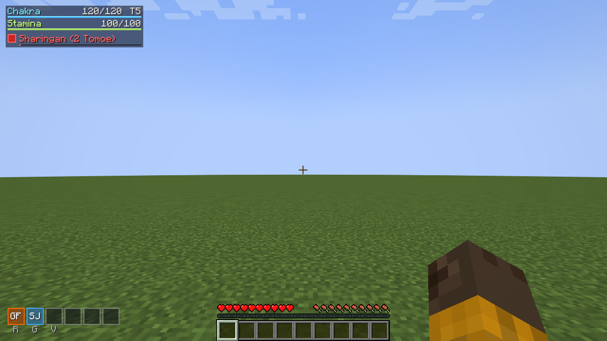

# MineAnime: AnimeCore + NarutoRPG (Minecraft 1.21.1 · Fabric · Java 21)

| Module | Package | Role | Jar |
|---|---|---|---|
| `:animecore` | `com.animecore.*` | Anime-agnostic RPG engine | ~233 KB (budget 1.5 MB) |
| `:narutorpg` | `com.narutorpg.*` | Naruto content mapped onto the engine | ~27 KB (budget 15 MB) |

Runtime deps (installed separately, **never bundled**): Fabric API, Cardinal Components API 6.1.x,
PlayerAnimator 2.0.x, GeckoLib 4.7.x. Optional: JEI, Lootr, Essential.

```bash
./gradlew build                    # builds both jars + verifyAssetBudget + verifyJarBudget (no nested jars)
./gradlew :narutorpg:runDatagen    # regenerates data/narutorpg/animecore/** + lang
./gradlew :narutorpg:runGametest   # 13 headless end-to-end tests (incl. a 2nd power system with flight)
./gradlew :narutorpg:runClient     # dev client with both mods
```

## Namespace isolation

| Thing | Owner | Example |
|---|---|---|
| Dynamic registries (shared engine) | `animecore` | `animecore:ability`, `animecore:lineage` ... |
| Registry **entries** | content mod | `narutorpg:fireball_jutsu` → `data/narutorpg/animecore/ability/fireball_jutsu.json` |
| CCA component | content mod | `narutorpg:power` (each mod has its own `PlayerPowerComponent`) |
| Energy pools | content mod | `narutorpg:chakra`, `bleachrpg:reiatsu` |
| Attribute modifiers | content mod | `narutorpg:trait/0` |
| Keybind category / keys | content mod | `key.categories.narutorpg`, `key.narutorpg.hotbar_1` |
| Combo tokens | content mod | `narutorpg:tiger` |
| Engine payloads | `animecore` (one engine per pack), they carry the `system` id | `animecore:hotbar_cast{system="narutorpg"}` |
| Mod-specific payloads | content mod | `AnimeModContext#payloadId("...")` → `narutorpg:...` |

Every definition has a `"system"` field naming the content mod that owns it, so datapacks can add
Naruto jutsu under any namespace and they still route to `narutorpg:power`.

## `com.animecore` package tree
```
com.animecore
├── AnimeCore                      ModInitializer (registries, networking, commands, damage/death hooks)
├── platform/                      version shield: Ids, AnimeRegistryAccess, AnimeNetworking,
│                                  AnimePacketCodecs, AnimeParticles, AnimeEnvironment
├── api/                           AnimeModContext(+Builder), EnergyPoolSpec, AnimeModRegistry, AnimeCoreApi
│   └── event/AnimeCoreEvents      PRE/POST_ABILITY_CAST, ENERGY_CONSUME, TRANSFORMATION_TOGGLE,
│                                  FATAL_DAMAGE_INTERCEPT, REACTIVE_DEFENSE
├── registry/                      AnimeRegistries (5 synced dynamic registries), AnimeBuiltinRegistries
│   └── definition/                AbilityDefinition, LineageDefinition, FactionDefinition,
│                                  AffinityDefinition, TransformationDefinition, EnergyCost, CastType
├── ability/                       AbilityExecutor (quick-cast / combo / charge / reactive), AbilityContext,
│   │                              AbilityDamage, CastResult
│   └── action/                    IAbilityAction (Codec.dispatch) + projectile, aoe_sphere, beam_raycast,
│                                  dash_strike, self_buff, summon_entity
├── trait/                         ITraitModifier (Codec.dispatch) + attribute, energy_capacity,
│                                  energy_regen, ability_power; TraitAccumulator
├── affinity/AffinityMatrix        clash multipliers + fusion (Kekkei Genkai) resolution
├── component/                     PlayerPowerComponent (CCA, schema_version), EnergyPool,
│                                  AnimeComponentInitializer
├── transformation/                TransformationService (toggle, drain, revert, stage evolution)
├── animation/                     AnimLayer (BASE 1000 / UPPER_BODY 1500 / OVERLAY 2000),
│                                  AnimPlayback, AnimationService (peer broadcast + late-joiner resync)
├── entity/                        EnergyProjectileEntity (texture-free), AnimeEntities
├── network/                       AnimationSyncPayload (S2C), Cast/HotbarCast/ComboInput/Transform (C2S)
├── command/AnimeCoreCommands      /animecore info|lineage|faction|unlock|unlockform|cast|transform|...
├── datagen/                       damage type + lang
├── movement/                      MovementMode, MovementSpec, AnimeMovementHandler (adhesion, flight,
│                                  burst step), MotionUtil
├── mixin/LivingEntityMixin        walls act as ladders + water is walkable while adhesion is on
│   ─ Phase 3: item/ (AnimeWeaponItem, AnimeDataComponents), loot/ (SetAbilityScrollFunction,
│     SetAnimeWeaponDataFunction), compat/jei/AbstractAnimeJeiPlugin
└── client/  (src/client/java, the only place MinecraftClient is referenced)
    ├── AnimeCoreClient
    ├── platform/AnimeClientNetworking
    ├── animation/AnimationLayerManager   PlayerAnimator ModifierLayer per AnimLayer, upper-body masking
    ├── network/AnimeClientPayloadHandlers
    ├── input/AnimeKeybinds               per-mod categories, press + release forwarding
    ├── hud/AnimeHudLayoutManager         per-mod panel groups stacked in TOP_LEFT / BOTTOM_LEFT
    │   └── element/                      EnergyBars, Transformation, AbilityHotbar, ComboTrail
    ├── combo/ComboWheelScreen            radial combo input with continuation hints
    └── render/                           ProceduralAuraRenderer, AfterimageEffects (texture-free)
```

## `com.narutorpg` package tree
```
com.narutorpg
├── NarutoRPG              AnimeModContext: chakra + stamina pools, hand-sign animations
├── NarutoComponents       CCA entrypoint (3 lines)
├── content/               NarutoContent (registry keys), HandSigns (tiger, ram, snake, bird, boar, horse)
├── mechanic/              NarutoMechanics: Fire jutsu fizzle underwater, Sharingan chakra discount
├── datagen/               NarutoDataGenerator, NarutoContentBootstrap, NarutoLangProvider
└── client/NarutoRPGClient keybinds (see below)
src/gametest/…             headless GameTests (not shipped)
```

## Controls (NarutoRPG, all rebindable under *Controls › NarutoRPG*)
| Key | Action |
|---|---|
| R / G / V | Jutsu slots 1-3 (hold to charge, release to fire) |
| Z (hold) | Hand-sign wheel: click or 1-6 to sign, release Z / right-click to perform |
| Numpad 1-6, Numpad 0 | Hand signs without the wheel / release |
| B | Toggle Sharingan · N / M next / previous stage |
| J | Chakra control: run up walls, walk on water (sneak to dive) |
| Left Alt | Body Flicker (Shunshin): 7-block blink toward WASD direction |




## Try it (dev client, cheats on)
```
/animecore lineage @s narutorpg:uchiha
/animecore faction @s narutorpg:hidden_leaf
Hold R to charge the Great Fireball, or hold Z and sign Snake › Ram › Boar › Horse › Tiger
Press B for the Sharingan, J for chakra control, Left Alt to Shunshin, G (Substitution) just before a hit.
/animecore info
```
