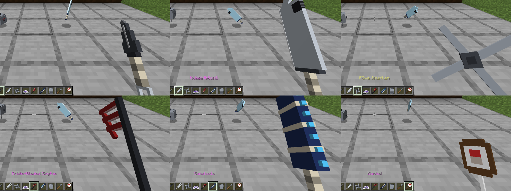
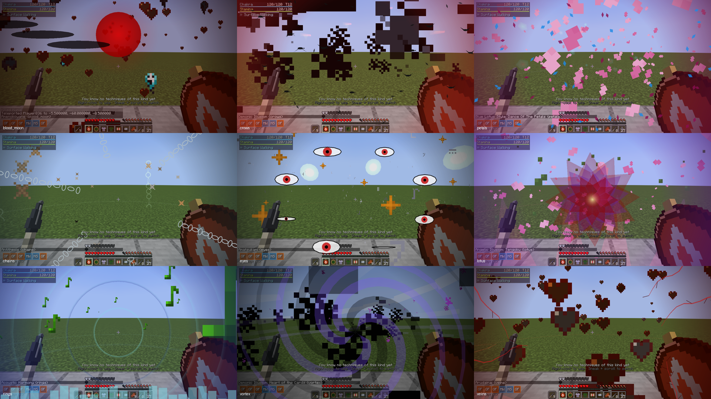
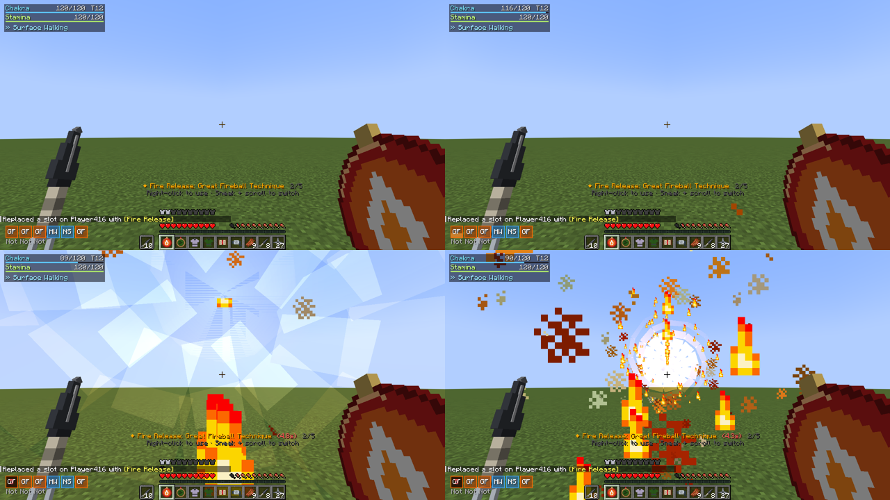
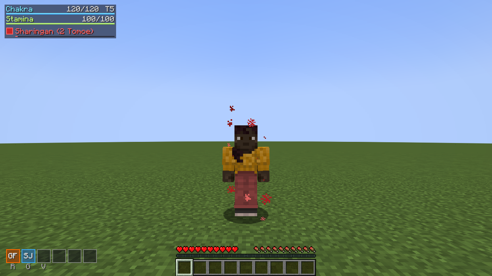
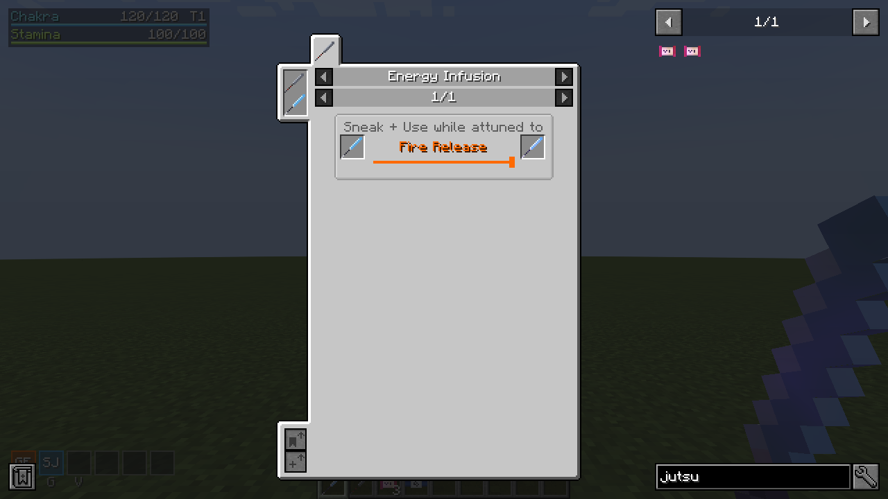

# MineAnime: AnimeCore + NarutoRPG + JoJoRPG (Minecraft 1.21.1 · Fabric · Java 21)

| Module | Package | Role | Jar |
|---|---|---|---|
| `:animecore` | `com.animecore.*` | Anime-agnostic RPG engine | ~437 KB (budget 1.5 MB) |
| `:narutorpg` | `com.narutorpg.*` | Naruto content mapped onto the engine | ~3.9 MB (budget 15 MB) |
| `:jojorpg` | `com.jojorpg.*` | JoJo's Bizarre Adventure Parts 1-3 content | ~0.7 MB |

Runtime deps (installed separately, **never bundled**): Fabric API, Cardinal Components API 6.1.x,
PlayerAnimator 2.0.x, GeckoLib 4.7.x. Optional: JEI, Lootr, Essential.

```bash
./gradlew build                    # builds both jars + verifyAssetBudget + verifyJarBudget (no nested jars)
./gradlew :narutorpg:runDatagen    # regenerates data/narutorpg/animecore/** + lang
./gradlew :narutorpg:runGametest   # 30 headless end-to-end tests (incl. every move of all 244 ninja tools)
python3 tools/catalog/build.py     # regenerate ninja_tools.json + 244 sprites (then runDatagen)
./gradlew :narutorpg:runClient     # dev client with both mods
./gradlew :jojorpg:runDatagen :jojorpg:runGametest   # JoJo content + its 17 end-to-end tests
python3 tools/catalog/jojo_content.py && python3 tools/catalog/jojo_story.py   # regenerate the JoJo catalogs (Parts 1-2)
python3 tools/catalog/jojo_stands.py && python3 tools/catalog/stand_models.py && python3 tools/catalog/jojo_part3_story.py   # Part 3
```

## Production standard (0.18.0)

Every mod goes through the same engine polish, and new features must meet it (CLAUDE.md "Production standard"):

| | |
|---|---|
| Themes | `AnimeTheme` per mod (accent / secondary colour, battle glyph, arc banner): JoJo purple-gold with ゴゴゴ, Naruto Konoha orange |
| HUD | themed glass panels with the mod's name and a rank badge; animated gradient bars with a damage ghost and low-energy pulse |
| Feel | `Juice`: camera shake and impact flashes on heavy hits (rushes, blasts, dashes, time stop, getting hit hard) |
| Title cards | boss intros (letterbox, slashes, the name slammed in, the Stand in 「」), chapter lower-thirds, "To Be Continued ⟵" / "Arc Complete" arc banners |
| Stands | summon animation, glowing aura, afterimages, menacing glyphs, the stopped-time dome |
| Words | every technique has a description in its item tooltip: 2,995 Narutopedia leads, 576 Fanon genjutsu, all JoJo techniques and Stands |
| Audit | `PolishAuditTests` in both mods (`com.animecore.qa.PolishAudit`): names, descriptions, animations, technique items, models, enemies with techniques |
| Showcase | `python3 tools/qa/showcase.py <mod>` plays `tools/qa/showcase_<mod>.txt` on the real jars in a fresh world and writes `dist/qa/<mod>/contact.png` |

## Several anime mods in one pack

The engine speaks neutral words (technique, faction, lineage, affinity, energy); each content mod
re-words the engine messages it cares about (`AnimeModContext.Builder#overrideText` + `assets/<mod>/engine_text.json`,
resolved by `AnimeText.tr(system, key)`): NarutoRPG says jutsu / clan / village, JoJoRPG says fighting style / technique.
Each mod has its own `PlayerPowerComponent`, energy pools, items and creative tabs. With several mods installed a mod's
HUD bars only show once the player has used that mod, and first-join random lineages are per mod (`ClanConfig.rollOnJoin`;
JoJo styles are learned from items, not rolled). Tested together: `:jojorpg:prodClient` launches all three jars.

## JoJoRPG: Part 1 Phantom Blood + Part 2 Battle Tendency (JoJo's Bizarre Encyclopedia)

Source: jojowiki.com `Category:Part 1` and `Category:Part 2`, crawled recursively (plus Vampires, Pillar Men, Items and
the Hamon / Vampire / Pillar Men / Stone Mask / Red Stone of Aja pages); coverage in `docs/wiki/jojowiki_parts_1_2.md`.

| | |
|---|---|
| Energy | Ripple (Hamon), Stamina, Blood |
| Fighting styles | **Hamon** (breathing refills the Ripple, blows sear the undead, walk on water), **Vampire** (Stone Mask: strength, regeneration, lifesteal, burns in the sun), **Pillar Man** (absorption, turns to stone in sunlight, Wind / Flame / Light Modes), **Cyborg** (German science: armour, machine guns, UV lamp), **Brawler** (Ogre Street / gentleman boxing) |
| Techniques | 86 - every `{{Tech}}` entry of the Part 1-2 characters (Zoom Punch, Sunlight Yellow Overdrive, Clacker Volley, Bubble Launcher, Snake Muffler, Space Ripper Stingy Eyes, Vaporization Freezing, Divine Sandstorm, Erratic Blaze King, Light Blades, UV Apparatus...) on 6 technique items |
| Forms | Wind Mode, Flame Mode, Light Mode, Ultimate Life Form (Red Stone of Aja; immune to the sun) |
| Items | Ripple Breathing Mask, Stone Mask, Pillar of the Ancients, Cybernetic Overhaul, Ogre Street Gloves, Red Stone of Aja, Style Manual, JoJo's Bizarre Journal, admin seals |
| Story mode | 113 quests (one per manga chapter) in 24 story arcs, 77 story characters (Dio grows from human rival to vampire lord; Straizo turns in Part 2; the Pillar Men) |
| World | zombies and vampires at night, Ogre Street thugs |

### Part 3: Stardust Crusaders - Stands (JoJoRPG 0.2.0)

Source: jojowiki.com `Category:Part 3` (recursively) + `Category:Stands` (its Part 3 members; its classification
subcategories decide each Stand's kind); coverage in `docs/wiki/jojowiki_part_3.md`.

| | |
|---|---|
| Stands | all 35 of `Category:Part 3 Stands` - Star Platinum, The World, Magician's Red, Hierophant Green, Silver Chariot, Hermit Purple, The Fool, Tower of Gray, Dark Blue Moon, Strength, Ebony Devil, Yellow Temperance, Hanged Man, Emperor, Empress, Wheel of Fortune, Justice, Lovers, Sun, Death Thirteen, Judgement, High Priestess, Geb, Khnum, Tohth, Anubis, Bastet, Sethan, Osiris, Horus, Atum, Cream, Tenore Sax, Holy's Stand, Jonathan's Stand |
| As entities | a Stand manifests as a real entity: it hovers at your shoulder, steps in to punch with you, rushes ("ORA ORA ORA!") with ghost fists, flies out for remote strikes; humanoid Stands are tinted figures, the others low-poly models (`stand_models.py`) |
| Powers | 141 Stand techniques from each page's abilities: time stop (The World 5 s, Star Platinum: The World 2.5 s; both move in stopped time), rushes, Emerald Splash, Crossfire Hurricane, Red Bind, Hanged Man's light-speed reflection strikes, Emperor's homing bullets, Justice's fog puppets, Lovers' pain link, Cream's void that erases blocks, Sethan's age reversal, Osiris' soul theft... |
| Getting one | Stand Arrow (random Stand), a Stand Disc per Stand (creative tab "JoJoRPG Stands", arc boss drops); the Stand item casts its techniques (right-click, sneak + wheel); Stand Energy bar |
| Story | 152 quests, one per chapter (114-265), in the 28 story arcs; 77 story characters, 72 fighting with their own Stand; the Joestar Group fights at your side with theirs; DIO's agents and vampires at night |

Engine features added for it (`animecore`): `animecore:manifestation` registry + `ManifestationEntity` + per-mod
Stand slot (`ManifestationService`, `/manifestation set|toggle|cast|clear`), actions `time_stop`, `rush`,
`remote_strike`, `charm`, `damage_link`, `void`, `attribute_shift`, `manifest`, homing projectiles, allied summons,
the `time_immune` trait, story characters with a `manifestation`, NPC technique cooldowns.

Engine features added for it: `undead`, `sunlight_weakness`, `breathing`, `lifesteal`, `undead_bane`, `sunlight_immunity`
traits, affinity `undead_multiplier` (the Ripple does 3x to the undead, UV 4x), `LineageAwakeningItem`, ambient
`animecore:story_spawn` entries, undead story characters.

## Namespace isolation

| Thing | Owner | Example |
|---|---|---|
| Dynamic registries (shared engine) | `animecore` | `animecore:ability`, `animecore:lineage` ... |
| Registry **entries** | content mod | `narutorpg:fireball_jutsu` → `data/narutorpg/animecore/ability/fireball_jutsu.json` |
| CCA component | content mod | `narutorpg:power` (each mod has its own `PlayerPowerComponent`) |
| Energy pools | content mod | `narutorpg:chakra`, `bleachrpg:reiatsu` |
| Attribute modifiers | content mod | `narutorpg:trait/0` |
| Keybind category / keys | content mod | `key.categories.narutorpg`, `key.narutorpg.hotbar_1` |
| Combo tokens | content mod | `narutorpg:tiger` |
| Engine payloads | `animecore` (one engine per pack), they carry the `system` id | `animecore:hotbar_cast{system="narutorpg"}` |
| Mod-specific payloads | content mod | `AnimeModContext#payloadId("...")` → `narutorpg:...` |

Every definition has a `"system"` field naming the content mod that owns it, so datapacks can add
Naruto jutsu under any namespace and they still route to `narutorpg:power`.

## `com.animecore` package tree
```
com.animecore
├── AnimeCore                      ModInitializer (registries, networking, commands, damage/death hooks)
├── platform/                      version shield: Ids, AnimeRegistryAccess, AnimeNetworking,
│                                  AnimePacketCodecs, AnimeParticles, AnimeEnvironment
├── api/                           AnimeModContext(+Builder), EnergyPoolSpec, AnimeModRegistry, AnimeCoreApi
│   └── event/AnimeCoreEvents      PRE/POST_ABILITY_CAST, ENERGY_CONSUME, TRANSFORMATION_TOGGLE,
│                                  FATAL_DAMAGE_INTERCEPT, REACTIVE_DEFENSE
├── registry/                      AnimeRegistries (5 synced dynamic registries), AnimeBuiltinRegistries
│   └── definition/                AbilityDefinition, LineageDefinition, FactionDefinition,
│                                  AffinityDefinition, TransformationDefinition, EnergyCost, CastType
├── ability/                       AbilityExecutor (quick-cast / combo / charge / reactive), AbilityContext,
│   │                              AbilityDamage, CastResult
│   └── action/                    IAbilityAction (Codec.dispatch) + projectile, aoe_sphere, beam_raycast,
│                                  dash_strike, self_buff, summon_entity
├── trait/                         ITraitModifier (Codec.dispatch) + attribute, energy_capacity,
│                                  energy_regen, ability_power; TraitAccumulator
├── affinity/AffinityMatrix        clash multipliers + fusion (Kekkei Genkai) resolution
├── component/                     PlayerPowerComponent (CCA, schema_version), EnergyPool,
│                                  AnimeComponentInitializer
├── transformation/                TransformationService (toggle, drain, revert, stage evolution)
├── animation/                     AnimLayer (BASE 1000 / UPPER_BODY 1500 / OVERLAY 2000),
│                                  AnimPlayback, AnimationService (peer broadcast + late-joiner resync)
├── entity/                        EnergyProjectileEntity (texture-free), AnimeEntities
├── network/                       AnimationSyncPayload (S2C), Cast/HotbarCast/ComboInput/Transform (C2S)
├── command/AnimeCoreCommands      /animecore info|lineage|faction|unlock|unlockform|cast|transform|...
├── datagen/                       damage type + lang
├── movement/                      MovementMode, MovementSpec, AnimeMovementHandler (adhesion, flight,
│                                  burst step), MotionUtil
├── mixin/LivingEntityMixin        walls act as ladders + water is walkable while adhesion is on
├── item/                          AnimeDataComponents (ability_scroll, weapon_infusion, faction_badge),
│                                  AnimeWeaponItem, AbilityScrollItem, FactionBadgeItem, AnimeItemVariants
├── loot/                          SetAbilityScrollFunction, SetAnimeWeaponDataFunction, AnimeLootFunctions,
│                                  AnimeLootHelper (vanilla injection + DataGen builders, Lootr-safe)
└── client/  (src/client/java, the only place MinecraftClient is referenced)
    ├── AnimeCoreClient
    ├── platform/AnimeClientNetworking
    ├── animation/AnimationLayerManager   PlayerAnimator ModifierLayer per AnimLayer, upper-body masking
    ├── network/AnimeClientPayloadHandlers
    ├── input/AnimeKeybinds               per-mod categories, press + release forwarding
    ├── hud/AnimeHudLayoutManager         per-mod panel groups stacked in TOP_LEFT / BOTTOM_LEFT
    │   └── element/                      EnergyBars, Transformation, AbilityHotbar, ComboTrail
    ├── combo/ComboWheelScreen            radial combo input with continuation hints
    └── render/                           ProceduralAuraRenderer, AfterimageEffects (texture-free)
com.animecore.compat.jei (client source set) AbstractAnimeJeiPlugin, AnimeComponentSubtypeInterpreter,
                                  AbilityScrollCategory, EnergyInfusionCategory
```

## `com.narutorpg` package tree
```
com.narutorpg
├── NarutoRPG              AnimeModContext: chakra + stamina pools, hand-sign animations
├── NarutoComponents       CCA entrypoint (3 lines)
├── content/               NarutoContent (registry keys), HandSigns, NarutoItems (kunai, chakra blade,
│                          jutsu scroll, leaf headband, creative tab, shinobi-cache loot injection)
├── mechanic/              NarutoMechanics: Fire jutsu fizzle underwater, Sharingan chakra discount
├── datagen/               NarutoDataGenerator, NarutoContentBootstrap, NarutoLangProvider,
│                          NarutoLootTableProvider, NarutoModelProvider
└── client/                NarutoRPGClient (keybinds), compat/NarutoJeiPlugin (one-line JEI plugin)
src/gametest/…             headless GameTests (not shipped)
```

## Ninja tools (Narutopedia `Category:Tools`)
All **244** tool pages (+3 index pages documented as skipped) are items, one creative tab per wiki
"Tool classification" group (Offensive / Defensive / Supplementary / Unclassified / Generic). Every tool has a
32x32 sprite, a melee attack (LEFT) with optional on-hit effect, a primary move (RIGHT) and a secondary move
(SNEAK+RIGHT), built from 24 reusable engine moves (`com.animecore.tool`). Full mapping: `docs/wiki/narutopedia_tools.md`.

- **Barrier Tag**: place one for a temporary 5x3 wall; place 3+ in sequence (within 10 blocks, 30 s) to link a lasting
  Barrier Gate that stands until a tag is broken.
- **Kunai**: stab, or throw (retrievable); with an Explosive Tag in the off-hand it becomes an explosive kunai.
- Puppets (Karasu, Kuroari, Sanshōuo, Sasori...) are allies on chakra threads; Flying Thunder God kunai mark & warp;
  sealing tags / Benihisago seal weakened foes; fans gust; Gunbai reflects; pills restore chakra; gliders fly...


**Low-poly 3D weapons**: 99 weapons (blades, polearms, thrown, fans, shields, gauntlets, launchers...) also ship a
Blockbench-style cuboid model generated from their design (`tools/catalog/model3d.py`, palette textures derived from
the sprite). Like the vanilla trident, the inventory shows the flat icon while hands, the ground, item frames and
thrown projectiles use the 3D model (engine: `com.animecore.client.render.HeldModels`, reusable by any anime mod).
Display transforms are derived from vanilla's handheld/generated transforms and tuned in-game.



## Clans & bloodlines (Narutopedia `Category:Clans`)

All **52 wiki clans** plus a **Clanless** fallback are playable lineages (`docs/wiki/narutopedia_clans.md` has the crawl,
member list and per-clan data). The clans carry **417 clan jutsu**, generated from each jutsu's wiki infobox (classification,
nature, range, rank, hand signs), plus 7 extra dōjutsu forms and 11 advanced natures (Wood, Ice, Lava, Magnet...).

- **One jutsu unlocked by default**. The rest unlock by **clan skill level**. Hold your **Clan Emblem** in either hand while
  defeating enemies: their experience becomes clan skill XP instead of orbs. Use the emblem to see your level and next unlock.
- **First join**: a weighted clan roll (gamerule `animecoreClanAutoRoll`, default on). With it off, players start Clanless and
  can `/clan choose <clan>` once. Rarer clans (Uchiha, Senju, Uzumaki, Hyūga, Ōtsutsuki...) have low weights. A **pity counter**
  guarantees a rare bloodline after 10 common rolls.
- **Bloodline Scroll**: an unsealed scroll rerolls (never your current clan). A sealed scroll (from loot) awakens that exact clan.
  Switching removes the old clan's jutsu, forms, stat modifiers and traits but keeps abilities you learned elsewhere. Clan level
  is saved per clan.
- **Starter kit** (once per clan): bound emblem, **Clan Garb** dyed in the clan colour, and the clan's signature tools from its
  members' wiki tool lists.
- **Clan traits** (`animecore:clan_trait_type`): evasion, energy discount, sensing, on-hit effects, regeneration, fatal save,
  passive effects and skill XP boost. Uchiha is the reference clan: +15% Fire Release power, +20 chakra, +1 attack, Fire affinity,
  Great Fireball by default, Sharingan stages at clan levels 3/10/20/35 and a Sharingan-precognition evasion trait.
- Commands: `/clan info|list|choose`, plus `/clan roll|set|skill|level` for operators. Loot function `animecore:set_lineage` (Lootr-safe).
  JEI shows every clan emblem as its own entry with an info page listing the clan's jutsu and items.
- Regenerate: `python3 tools/catalog/clans.py` (catalog, sprites, doc) then `./gradlew :narutorpg:runDatagen`.

## Forms: tailed beasts, curse marks, Kāma, modes, kekkei genkai / mōra / tōta

59 new forms (70 in total), awakened with 28 sealed-power items. Story arcs hand them out where the story does
(One-Tails seal in Kazekage Rescue, curse marks in the Chūnin Exams / Sasuke Recovery, Sage scroll in Tale of Jiraiya,
Nine-Tails in Pain's Assault, Kāma in Versus Momoshiki...). Bloodline awakenings and curse marks can also appear as
very rare cache loot, and every item is in the creative tab. Use the item, then switch the form on from its
technique item. Later stages **evolve with mastery** (time spent in the form).

| Technique item | Forms |
|---|---|
| **Jinchūriki** | All nine tailed beasts: Version 1 → Version 2 → Tailed Beast Mode (Nine-Tails Chakra Mode for Kurama) → Full Tailed Beast Transformation (you become a giant). Plus Baryon Mode and the Ten-Tails Jinchūriki. |
| **Senjutsu** | Sage Mode → Six Paths Sage Mode |
| **Fūinjutsu** | Cursed Seal of Heaven / Earth (Level 1 → 2), Kāma → Kāma: Ōtsutsuki Awakening |
| **Dōjutsu** | New: Susanoo (giant chakra armour), Eternal Mangekyō, Rinne Sharingan (the kekkei mōra techniques), Tenseigan Chakra Mode, Ranmaru's dōjutsu. Existing: Sharingan stages, Mangekyō, Byakugan, Rinnegan, Tenseigan, Jōgan, Ketsuryūgan, Kokugan, Senrigan. |
| **Kekkei Genkai** | Shikotsumyaku, Jūgo clan Sage Transformation, Iburi smoke body, Kurama clan genjutsu, Rinha absorption, Ryūzetsu's Dragon Life, Sakon and Ukon's fusion, Yanaru's clone link |

**What a form gives you:**
- Stat powers: strength, armour, speed, size, max health.
- Bloodline-style traits: regeneration, evasion, sensing, on-hit effects, a death save.
- The jutsu its Narutopedia users wield. Shukaku's sand claws, Gyūki's ink and Kurama's tailed beast balls are
  castable while the form is active.
- An aura plus a translucent chakra cloak in the form's colour.

The kekkei genkai natures (Wood, Lava, Dust...) were already in the game as nature releases. Coverage is listed in
`docs/wiki/narutopedia_forms.md` and the generator is `tools/catalog/forms.py`.

### Low-poly models: tailed beasts and Susanoo

The full tailed-beast transformations, Susanoo and the story's tailed-beast bosses use **custom low-poly models**:
Shukaku, Matatabi, Isobu, Son Gokū, Kokuō, Saiken, Chōmei, Gyūki, Kurama, the Ten-Tails and Susanoo.

- **References:** each was modelled from the Narutopedia page image of that beast. Palettes are the dominant colours
  sampled from those images, which were used only as references and are not shipped.
- **Animation:** legs walk, tails and tentacles sway, wings flap, jaws open and heads follow your view.
- **Tools:** the models are generated by `tools/catalog/beast_models.py`, and
  `python3 tools/catalog/form_preview.py out.png` renders an offline preview sheet.
- **Engine:** models are data in `assets/<ns>/form_models/` (boxes + animation tags, vanilla model parts, no extra
  libraries), so any form or story character can name one with `"model"`.
- **Story bosses:** the arcs where the beasts rampage now end with a boss fight against them: Shukaku in Konoha
  Crush, Isobu in Three-Tails' Appearance, Saiken in Six-Tails Unleashed, Gyūki in Fated Battle Between Brothers,
  the reanimated beasts in the Fourth War, and the Ten-Tails.

## Jutsu schools: Hiden, Medical, Fūinjutsu, Bukijutsu, Dōjutsu, Kekkei Genkai techniques

There are 1,386 Narutopedia techniques across these schools and their sub-types (Regeneration, Juinjutsu, Kenjutsu,
Shurikenjutsu, Kekkei Mōra / Tōta). They are all in the game; 103 are new in this release. Coverage is listed in
`docs/wiki/narutopedia_schools.md` and the generator is `tools/catalog/schools.py`.
- Weapon techniques now have their own **Bukijutsu** technique item.
- **Medical ninjutsu heal allies**: every player, tamed animal and friendly story character within 6-9 blocks of the
  medic.

## Story mode: quest scroll (every Narutopedia arc and movie)

Every player gets a **Quest Scroll** on their first join. Use it to open the **Story Journal**, which covers all
**92 arcs and movies** from Narutopedia (`Category:Arcs` + `Category:Movies`): Naruto, Shippuden, Boruto (including
Two Blue Vortex), the Gaiden / Hiden / Shinden stories and all 11 movies. That's **635 story quests** and
**477 story characters**. Coverage is listed in `docs/wiki/narutopedia_story.md` and the generator is
`tools/catalog/story.py`.

- **Chapters:** each arc's summary sections (or its episodes / chapters for short arcs) become quest chapters.
  - Talk to the chapter's quest giver; the story text plays in a dialogue box.
  - Travel to the encounter site, marked on the HUD with an arrow and distance.
  - Fight the chapter's enemies with its allies at your side, or meet the next character / train for story chapters.
- **Order:** canon arcs form the main chain (Naruto → Shippuden → Boruto). Anime-only arcs are optional side stories
  that open alongside the canon arc they follow, and movies open in their era. Finishing a canon arc raises your rank,
  taking you from genin rank 1 to rank 16 by the end of Boruto.
- **Story characters:**
  - **Look:** built from their wiki data (clan, village, kekkei genkai) plus hand-tuned looks for the main cast.
    Skin, hair style, outfit (flak jacket, Akatsuki cloak, robes, armour...), headband and face marks are tinted
    layers, so they cost almost no assets.
  - **Combat:** enemies and bosses fight with the jutsu Narutopedia lists for them, era-appropriate (no Baryon Mode
    in Part I). Bosses have a boss bar.
  - **Allies and givers:** allies follow and defend you; quest givers can't be hurt.
- **Journal:** series tabs, collapsible arcs, each chapter's story, objectives and rewards, and Accept / Abandon /
  Call again (respawns lost characters).
- **Admins:** `/quest start|complete|unlock|reset <player> ...`. The **Story Seal** (admin tab) completes the current
  quest; sneak + use completes the rest of its arc.

## Ninjutsu (Narutopedia, every ninjutsu)

Narutopedia has no `Category:Ninjutsu` page. Ninjutsu are grouped by the "Jutsu classification" filter, so the
crawl covers *Ninjutsu* and every ninjutsu sub-type: Barrier, Clone, Cooperation, Medical, Reincarnation, Space–Time,
Chakra Absorption, Chakra Flow, Regeneration and Shape Transformation. That is **2,455 pages**: 859 are new abilities,
1,576 already existed as clan, village, nature-release or taijutsu techniques, and 20 are nature / kekkei genkai pages
that are already in the game as natures. Coverage is listed in `docs/wiki/narutopedia_ninjutsu.md` and the generator is
`tools/catalog/ninjutsu.py`.

- New ninjutsu go on the **Ninjutsu** item or their school's item (Fūinjutsu, Hiden, Dōjutsu, Medical, Taijutsu) and
  unlock through mastery like every other jutsu.
- Each is built from its wiki infobox: attacks become projectiles, beams or bursts; binds and prisons hold targets;
  barriers raise walls; medical ninjutsu heal.
- New utility types:
  - **Sensing** reveals every creature within 32 blocks.
  - **Hiding / camouflage** makes you invisible.
  - **Traps and webs** root enemies in front of you.
  - **Possession / mind / curse** confuses and weakens them.
  - **Sealing** suppresses enemies' strength.
  - **Reincarnation** heals you and grants absorption.
  - **Space–time teleport strikes** (Flying Thunder God) blink you up to 18 blocks, hitting everything on the way.

## Taijutsu (Narutopedia, all 657 techniques)

Narutopedia has no `Category:Taijutsu` page; taijutsu are grouped by the "Jutsu classification: Taijutsu" filter, and
all 657 pages in it are in the game. 475 are new; the other 182 already existed as clan, village or nature jutsu.
Coverage is listed in `docs/wiki/narutopedia_taijutsu.md` and the generator is `tools/catalog/taijutsu.py`.

- They sit on the **Taijutsu** item (Gentle Fist moves go on the Dōjutsu item). Hold it while defeating enemies to
  master the next technique. Pure taijutsu costs **stamina**, not chakra.
- Each technique plays as a move type matched from its name, with its own animation:

| Move type | Examples | What it does |
|---|---|---|
| Barrage | Multiple Connected Fists, Great Combo Attack | dash with 4-6 rapid follow-up blows |
| Lotus | Front / Reverse Lotus | launch the target, then a combo |
| Rising strike | Leaf Rock-Destroying Rise | launches the target upward |
| Spin | Wild Boar Spin, Leaf Whirlwind | spinning burst that knocks back everything around you |
| Drop / slam | Heel drops, Earth-Shattering | dash and ground impact |
| Charge | Human Bullet Tank, Lightning Speed | long charge through enemies |
| Air pressure | Vacuum Palm, Leaf Gale | air wave fired forward |
| Slash | Fang, claw and blade moves | piercing close-range cut |
| Grapple | Windmill Throw, Clone Lasso | pull in, slow and toss up |
| Kick / punch | everything else | striking dash with knockback |
| Eight Gates | Eight Gates Released Formation | power-up that scales with the gate number (costs hunger) |

Guy's Gate moves are tuned by hand: Morning Peacock (fiery barrage), Daytime Tiger (huge air tiger), Evening
Elephant (crushing pressure beam), Night Guy (a 22-block charge).

## Admin / cheat seals (creative tab "NarutoRPG Admin")

These are for testing and server staff. Only operators (permission level 2) or players in creative mode can use them,
and they're never used up. Right-click does a small step; sneak + right-click does a big one.

| Seal | Use | Sneak + use |
|---|---|---|
| Rank Up Seal | +1 rank | +10 ranks |
| Clan Awakening Seal | +1 clan skill level (unlocks follow) | max clan level |
| Mastery Seal | +1 mastery on the jutsu item in your other hand | master it fully (empty hand: all your items) |
| Skill Point Seal | +5 skill points | +50 |
| Nature Seal | all basic natures | all 23 natures |
| Reputation Seal | +50 with every village | allied with all |
| Chakra Seal | refill all energy and clear every cooldown | same |
| Kage Seal | max rank and clan level, master all your natures, refill | same |

Big unlocks post one summary chat line instead of hundreds.

## Fan genjutsu (Naruto Fanon `Category:Genjutsu`), each with its own vision

All **582 genjutsu** from the Naruto Fanon wiki are in. That covers the main category plus the *Path Gold Alignment
Techniques* and *The Way of the Evil Path* subcategories. The *Genjutsu User* and *Specialist* subcategories list
characters, so they were skipped; see `docs/wiki/narutofanon_genjutsu.md`.

- **Unique visuals per genjutsu**: each one has an `illusion` profile.
  - The pattern comes from its own description, out of 20 procedural patterns: blood moon, crow flock, petals, lotus,
    shattered mirror, fog, chains, watching eyes, darkness, flames, stars, spider web, sound rings, rain, vortex,
    serpents, blood veins, kaleidoscope, snow and spiral.
  - Colours come from the colour words in its description, and the element count, speed, density and particle differ
    per technique.
  - A uniqueness pass guarantees that no two genjutsu look alike.
- Victims see the vision full-screen; everyone nearby sees the matching world effect (crows circling, a moon overhead,
  chains rising, a lotus blooming...).
- Effects follow the motif: chains bind, flames burn, vortices pull, serpents poison, and lotus heals the caster.
- They live on the **Genjutsu** item and unlock through Genjutsu mastery. Ops can preview any one with `/vfx genjutsu <id>`.



## Nature releases (Narutopedia `Category:Chakra Natures`)

All **23 nature releases** are in: the 5 basic natures; Yin, Yang and Yin–Yang; Wood, Ice, Lava, Magnet, Storm, Boil, Scorch,
Explosion, Dust and Mud; and Crystal, Dark, Steel, Swift and Typhoon. Each has its own release item. They carry **1,286
nature jutsu** taken from the wiki, 1,078 of them new; the full list is in `docs/wiki/narutopedia_natures.md`.

- Choosing an origin gives you a **basic nature**, which leans toward your village's element, plus its first jutsu. Clan
  natures (Uchiha Fire, Senju Wood...) count too.
- **Nature mastery**: hold a release item while defeating enemies to gain mastery XP. Each level unlocks the next jutsu of
  that release in rank order. A release outside your natures trains 2.5× slower. Training a basic release to level 10 makes
  it your nature.
- **Fusions** awaken once you hold both natures (Lava = Fire + Earth, Storm = Water + Lightning, Mud = Earth + Water...).
  Wood, Ice and Magnet stay clan kekkei genkai. Crystal (Earth 30), Typhoon (Wind 30), Dark (Yin 30), Steel (Earth 40) and
  Swift (Lightning 30) awaken through mastery.
- Clan and village jutsu keep their own unlock systems. Scrolls still teach single jutsu.

## Village origins & backgrounds (Narutopedia `Category:Villages`)

All **40 wiki villages** are factions (18 hidden villages, 19 civilian villages, 3 sage realms), plus the **Missing-nin**
rogue alignment. There are **5 backgrounds**: Academy Prodigy, Shinobi Orphan, Anbu Trainee, Wandering Mercenary and
Merchant / Artisan Scion. The crawl and per-village data are in `docs/wiki/narutopedia_villages.md`.

- **First join** opens the *Choose Your Origin* screen: pick a village and an upbringing, or press *Randomize Origin*.
  The server validates the choice: the village must be selectable, the background must be allowed there, and you can't
  choose again without a reset. Commands are `/origin open|choose|random|info` (also `/naruto origin ...`). Ops get
  `/origin set|reset`. **Forged Papers** reset your origin. Gamerule `animecoreOriginScreen=false` rolls a random origin instead.
- **Starter kit**: forehead protector and flak jacket dyed in the village colour, kunai, shuriken and explosive tags,
  your background's bonus items, skill points and rank, the village's first techniques, and starting standings
  (e.g. Leaf-Sand +50, Leaf vs Cloud/Stone -25, every village -50 toward missing-nin).
- **Village techniques** (125 across the villages, taken from what each village's shinobi use on the wiki) unlock as your
  rank rises. Outsiders can only learn them from captured scrolls at rank 5 or with allied standing, and can't cast them
  below that.
- **Village-exclusive gear** (94 tools, e.g. the Seven Swords for Kiri and puppets for Suna): members and allies with
  reputation 50+ get full use. Outsiders deal half damage and can't use the gear's moves or chakra infusion. Foreign
  uniforms are taken off. Tooltips show the requirement.
- **Go rogue**: sneak and use your forehead protector with a blade in the other hand to scratch the symbol. You become
  missing-nin: home reputation drops by 100 and its allies by 25, and the scratched band marks you.
- Loot: village supply caches (`narutorpg:chests/supply/<village>`) placed in fitting vanilla chests, plus the
  `animecore:set_faction` loot function. JEI has an info page for each village's headband.

## Technique effects & animations (every jutsu, present and future)

Every ability is animated by the engine from its data, so new techniques from any content mod get effects automatically:
- **Style resolution**: the ability's `visuals.style`, then its affinity's `vfx_style`, then a keyword guess from the ids, then
  generic energy. There are 18 styles: flame, water, wind, lightning, earth, ice, plant, lava, sand, shadow, light, illusion, space,
  poison, blood, insect, smoke and energy.
- **Projectiles** are procedural swirling elemental balls. Spiral arms wrap in toward the core (Great Fireball), and the styles add
  lightning arcs, wind rings, tumbling rock or wood chunks and dark matter. Particles spiral into the ball as it flies.
- **Actions**: beams get glow ribbons (jagged for lightning) with helix strands, shockwaves get rings and a wave front, area techniques
  get a ground rune circle and cone sweep, walls erupt from the ground, buffs raise an aura helix, dashes leave streaks, impacts burst,
  and caught targets get a sigil above their head.
- **Screen effects**: genjutsu vision (tint, vignette, rotating three-comma spiral, ripples, petals), shadow darkness closing in,
  and a blinding flash. These are picked automatically from the ability's effects (nausea means illusion) or set by `visuals.screen_effect`.
- **Cast animations**: every ability without its own animation gets one by type: exhale, thrust, point, burst, gaze, sweep, slam,
  focus or lunge (`tools/catalog/animations.py`).
- Preview with `/vfx play <kind> <style>` and `/vfx screen <illusion|darkness|flash> [style]` (ops).

## Controls: item-based, no keybinds needed (AHZNB-style)
Jutsu live on **jutsu items (tokens)**: one per nature release (Fire, Wind, Lightning, Earth, Water, Wood, Ice, Lava, Magnet,
Storm, Boil, Scorch, Explosion, Dust, Yin, Yang) and one per school (Ninjutsu, Taijutsu, Genjutsu, Fūinjutsu, Medical
Ninjutsu, Hiden, Dōjutsu). Learning a jutsu hands you its token (once; `/jutsu tokens` replaces lost ones).

| Action | How |
|---|---|
| Use the selected jutsu | Hold the token, **right-click** (hold for charged jutsu, release to fire) |
| Switch jutsu | **Sneak + mouse wheel**, or **sneak + left-click** |
| Activate / switch eyes (Sharingan, Byakugan...) | The **Dōjutsu** token: right-click, or sneak + wheel to pick the eye |
| See what a token holds | Tooltip lists every jutsu with cost; the selected jutsu and its cooldown show above the hotbar |
| Walk on water | Automatic while you have chakra (sneak to dive) |
| Climb walls / trees | Jump at the wall while **looking up**; sneak to cling |
| Body Flicker (Shunshin) | **Sneak + jump** |

Techniques added later are placed on a token automatically: their `token` field, else their nature, else Ninjutsu.
The old keybinds (jutsu slots, hand-sign wheel, Sharingan, chakra control, Shunshin) still exist under
*Controls › NarutoRPG* but are **unbound by default** for players who prefer keys.









## Items & loot (Phase 3)
| Item | Behaviour |
|---|---|
| Kunai / Chakra Blade | Sneak+Use infuses with your affinity (bonus elemental damage per hit, frontal projectile deflection); hold Use for a charged slash |
| Jutsu Scroll | `animecore:ability_scroll` component; use to learn the technique |
| Hidden Leaf Headband | `animecore:faction_badge`; use to join the Hidden Leaf |

`narutorpg:chests/shinobi_cache` is injected (40%) into dungeons, mineshafts, weaponsmiths and outposts.
All randomness comes from the loot context, so Lootr's per-player chests each roll their own scroll/element.

## Try it (dev client, cheats on)
```
/animecore lineage @s narutorpg:uchiha
/animecore faction @s narutorpg:hidden_leaf
Hold R to charge the Great Fireball, or hold Z and sign Snake › Ram › Boar › Horse › Tiger
Press B for the Sharingan, J for chakra control, Left Alt to Shunshin, G (Substitution) just before a hit.
/animecore info
```
